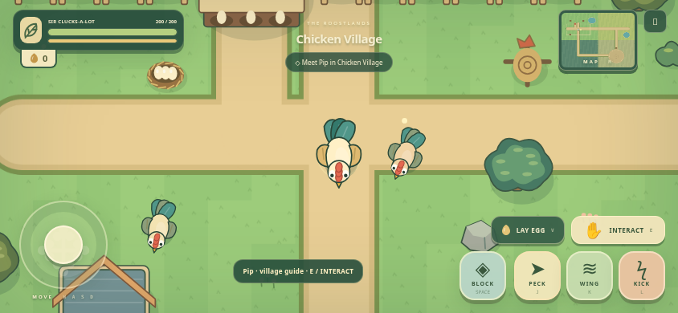

# Chicken Simulator v0.2 — The Roostlands

**Small wings. Big world.** A top-down countryside action adventure for Android browsers. Explore, fight, collect questionable eggs, upgrade, and earn the Golden Comb.

The old side-view battle scene has been replaced completely. Movement, combat, loot and interaction now happen in one continuous world, with a smooth following camera and a multitouch joystick.



## The world

| Zone             | What is actually playable                                                                                                                                  |
| ---------------- | ---------------------------------------------------------------------------------------------------------------------------------------------------------- |
| Chicken Village  | Safe hub with houses, fences, Pip and Mabel, nests, the Feather Forge shop, signs, a training dummy and automatic health recovery.                         |
| Sunny Fields     | Rookie and Speedy roosters, hay bales, crates, wild nests, trees, a pond and hidden egg stashes. Follow the eastern path.                                  |
| Dark Forest      | Dense groves, mushrooms, rocks, fallen logs, stronger Bramble roosters and hidden rewards. Take the southern village path.                                 |
| Champion’s Arena | A ring, banners, spectators and a challenge bell. Ring it to fight Lord Cluckington directly on the map. First victory awards 25 eggs and the Golden Comb. |

The world is 3072×2304 units (48×36 navigation tiles). All areas are connected by walkable paths. Obstacles block movement and sight; grass, flowers and mushrooms are decoration. Enemies detect through clear sight, follow paths around cover, occasionally reposition, and return home if pulled too far. The village is safe. Enemy respawns happen after 75 seconds, only away from the player.

## How to play

| Action             | Phone                          | Keyboard          |
| ------------------ | ------------------------------ | ----------------- |
| Move freely        | Left joystick                  | WASD / arrow keys |
| Peck               | PECK                           | J                 |
| Wing slap          | WING                           | K                 |
| Power kick         | KICK                           | L                 |
| Block              | Hold BLOCK                     | Hold Space        |
| Lay egg            | LAY EGG                        | V                 |
| Interact           | INTERACT near a glowing object | E                 |
| Map and objectives | Minimap                        | M                 |
| Pause              | Pause button                   | Escape            |

Face enemies to attack. There is modest forward target assistance, never a turn-around auto-hit. Peck is fast and short; wing slap has a wide arc; kick has a visible windup and strong knockback. Alternate attacks for a combo. Watch red enemy arcs and walk out of them. Blocking absorbs 78% of damage but drains stamina. Release attacks and block to recover. Enemies cannot hit through solid cover.

Meet Pip, defeat a Rookie, collect 10 eggs, buy an upgrade, enter the forest, and challenge the Champion. The gold minimap marker shows your next objective; open the atlas to see all six goals and four zones.

Nests grant 3 eggs and refill after 60 seconds. Crates can be opened or struck and may contain 2 eggs. Hidden stashes grant 5 eggs once. Enemy rewards range from 3 to 5 eggs; the Champion grants 25 on first victory and 10 on later challenges. Lay Egg grants one egg every 30 seconds, improved to 10 seconds at maximum production level. Rewards are credited and saved immediately, then shown as animated world eggs, so switching apps cannot lose an award. Laying briefly prevents attacking, blocking and movement. Rival eggs add to their defeat reward.

Visit the striped **Feather Forge** stall in Chicken Village to spend eggs. Attack, max health, stamina and production have five levels and rising costs. Upgrades affect current gameplay immediately. Defeat returns you to the village without taking eggs or upgrades. Leaving the arena zone withdraws the boss challenge so you can heal and try again.

## Review and play before merge

Repository identity was verified as **`Ilyanius31/chiken-simulator`**. The feature branch is **`feat/top-down-world-v0.2`**, based on v0.1 commit **`e52501e`**, not on the empty original `main`.

Every push to this branch runs **Test, preview and deploy Chicken Simulator**. After the build passes:

- The **chicken-simulator-v0.2-preview** Actions artifact contains the `dist` site and **`chicken-simulator-v0.2.html`**, a self-contained downloadable preview. Open [Actions](https://github.com/Ilyanius31/chiken-simulator/actions), select the latest feature-branch run and download the artifact. Local HTML support depends on the Android browser/file handler; this is not represented as a public HTTPS preview.
- Source screenshots and the validation report are in `docs/`. No live pre-merge URL is claimed without an actual deployment.

## Publish after your review

1. Review and merge the PR yourself. The agent/workflow must not merge it.
2. If Pages is not enabled yet, open [Settings → Pages](https://github.com/Ilyanius31/chiken-simulator/settings/pages) on your phone. Under **Build and deployment → Source**, choose **GitHub Actions**. Chrome’s **Desktop site** can reveal hidden GitHub settings controls.
3. The merge to `main` triggers type checking, tests, formatting, build, upload and the official GitHub Pages deployment. If the first deploy ran before Pages was enabled, rerun the workflow on `main`.
4. Wait for a green **deploy** job, then use its HTTPS URL or **Settings → Pages → Visit site**.

The expected address for this repository is `https://ilyanius31.github.io/chiken-simulator/`. It is an expected address, not a claim that the site is currently published. No API keys are required. The deploy job has only `pages: write` and `id-token: write`; all other jobs get only the permissions they need. Feature-branch and PR builds never overwrite the Pages site.

## Develop and test

Node 22.12+ and npm are required for development, not for playing. There are no runtime npm packages, remote fonts or fetched game assets.

```sh
npm ci
npm run dev
npm run typecheck
npm test
npm run test:browser
npm run build
npm run preview:pack
npm run preview
```

The default path is **`/chiken-simulator/`**, matching the real repository. CI can override it with `PAGES_BASE_PATH` if the repository is renamed. All production assets use that subpath. The application has no server-side routes.

Playwright uses `/usr/bin/chromium` in Codex Cloud. Set `CHROMIUM_PATH` on another machine. It controls the actual game through keyboard/touch input; read-only Canvas data attributes expose position/enemy snapshots for assertions. Tests do not teleport the browser player, replace combat outcomes, or add test currency to the playthrough. A separate migration fixture intentionally supplies a v0.1 save.

`npm run format` formats sources; `npm run format:check` checks them. `npm run preview:pack` bundles production JS, CSS and the favicon into `artifacts/chicken-simulator-v0.2.html`. It fails on unexpected code splitting instead of silently emitting a broken preview. Generated artifacts are ignored by Git and uploaded by CI.

## Architecture

```text
src/core/       combat, AI, balance, economy, save migration, game lifecycle
src/world/      authored map, camera, collision/navigation, interactions, simulation
src/render/     original overhead rooster art, environment art, cached terrain/effects
src/platform/   independent multitouch joystick/buttons, keyboard, Web Audio
src/ui/         menu, HUD, shop, atlas, dialogue, pause/settings/results
```

The simulation advances at 60 fixed steps per second with bounded catch-up. Movement, combat, collision, camera, navigation, interactions and economy can be tested without a browser. Rendering culls off-screen objects, caches static terrain, caps device pixel ratio at 2 and uses no external art assets. Enemies use simple state transitions and bounded grid pathfinding rather than an AI library.

The previous economy, upgrade categories, procedural audio, storage validation/backup design and testing tools were reused. The old camera, side-view renderer, one-dimensional collision, battle screens and two-button movement were replaced.

### Saves

`chicken-simulator:v2` stores eggs, upgrades, records, sound settings, exploration position, discovered zones, collected objects/respawn deadlines, objective progress and the Champion reward. A v0.1 save at `chicken-simulator:v1` is migrated safely; its original data is preserved. Fields are validated individually, a healthy previous v0.2 revision is backed up, and unknown newer schemas cannot be overwritten. Only the explicit confirmed reset removes both generations. When storage is unavailable, the game warns and remains playable in the current tab.

Saved positions inside changed geometry are moved to the village safely. Returning from a closed session restores position with full health; combat encounters are not serialized. Progress belongs to this browser and origin, so clearing site data or changing domain loses access to that local save. There is no account or cross-device sync.

## Phone acceptance check

After opening the real deployed HTTPS site, test landscape movement and simultaneous attacks with both thumbs; release/cancel touches and switch apps to check pause behavior. Talk to Pip, collect a nest, lay an egg, practice on the dummy, open a crate, defeat a Rookie and purchase an upgrade at the physical shop. Visit the forest and ring the arena bell. Reload to verify currency, upgrades, objectives and settings persist. Rotate to portrait for the guidance screen and back to resume. Listen to sounds after the first touch, then mute them.

Browser emulation does not establish physical Android frame rate, audio behavior or thumb comfort. Those remain device checks. v0.2 intentionally has one authored world, no multiplayer, inventory/crafting, backend, monetization or service worker. Next work should prioritize phone playtest feedback, boss balance and save export/import before adding larger systems.
