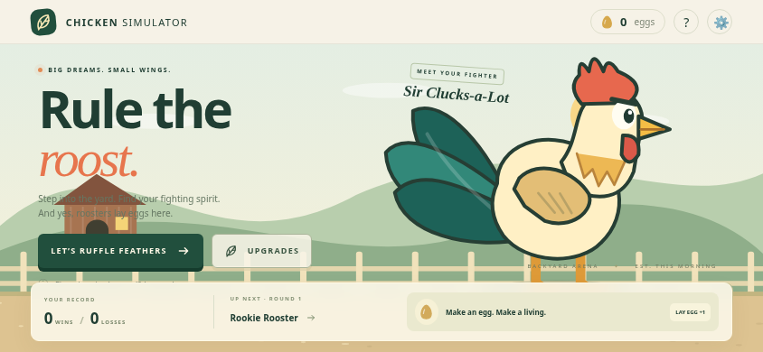

# Chicken Simulator · v0.1

**Small wings. Big ambitions.** A lightweight, original 2D arcade fighter for Android browsers. Play as Sir Clucks-a-Lot, climb the pecking order, lay biologically questionable eggs, and invest them in a better bird. Cartoon slapstick only; no blood or realistic animal violence.



## Play and publish from an Android phone

The connected repository is currently **`Ilyanius31/chiken-simulator`** (spelled `chiken`, without the second `c`). The game title is **Chicken Simulator**. No repository rename is required. The deploy workflow automatically uses the real repository name for asset paths.

**Publication status:** the repository contains everything needed for GitHub Pages. A successful public deployment must still be confirmed in GitHub Actions; a configured workflow is not proof of publication. No public URL is claimed as live here.

1. Open the feature branch comparison in Chrome: [Prepare the v0.1 pull request](https://github.com/Ilyanius31/chiken-simulator/compare/main...feat/chicken-simulator-v0.1?expand=1). Tap **Create pull request**, then create it with title `Chicken Simulator v0.1 — first playable mobile release`. If GitHub hides controls, enable Chrome’s **Desktop site**.
2. Wait for the **Test and deploy Chicken Simulator / build** check. Open changed files if desired, then **Merge pull request → Confirm merge**. The agent does not push to `main`.
3. Open [Settings → Pages](https://github.com/Ilyanius31/chiken-simulator/settings/pages). Under **Build and deployment → Source**, choose **GitHub Actions**. You need repository administrator access. No API token or secret is required.
4. Open [Actions](https://github.com/Ilyanius31/chiken-simulator/actions), choose **Test and deploy Chicken Simulator**. If the merge run failed before Pages was enabled, tap **Re-run all jobs**; or **Run workflow**, choose `main`, and run it.
5. Wait until both **build** and **deploy** are green. Open the HTTPS link in the deployment summary or **Settings → Pages → Visit site**. With the current repository name, the expected address is `https://ilyanius31.github.io/chiken-simulator/`. This is an expected address, not a verified live link.
6. Rotate the phone horizontally and play. Chrome → **Add to Home screen** is optional; no application installation is required.

If you rename the repository to `chicken-simulator`, the next workflow run automatically builds for `/chicken-simulator/`, and the expected site becomes `https://ilyanius31.github.io/chicken-simulator/`. Update bookmarks after a rename. For a private repository, Pages availability depends on your GitHub plan; use a public repository if Pages settings say it is unavailable.

### Deployment details

`.github/workflows/deploy.yml` runs on pushes to `main`/`master`, pull requests (validation only) and manual dispatch. It uses Node 22, `npm ci`, strict TypeScript checks, Vitest, and the production build. Official `configure-pages`, `upload-pages-artifact`, and `deploy-pages` actions publish `dist`. Only the deploy job gets `pages: write` and `id-token: write`; build has `contents: read`. The `github-pages` environment exposes the resulting URL. GitHub’s default Pages environment allows deployment from the default branch; a nondefault manual run may need environment approval. Prefer `main` for release.

## Controls

| Action | Touch | Keyboard |
| --- | --- | --- |
| Move | Left/right arrows under left thumb | A/D or arrow keys |
| Peck | PECK | J |
| Wing slap | WING SLAP | K |
| Power kick | POWER KICK | L |
| Block | Hold BLOCK | Hold Space |
| Lay egg | LAY EGG | V |
| Pause | Pause button | Escape |

Move close before attacking. Hold an attack to repeat when ready; alternate attacks for up to a 4× combo (10% extra damage per additional step). The kick has a visible windup and a long cooldown. Blocking reduces damage by 78%, drains stamina, and temporarily breaks when exhausted. Recover stamina by releasing attacks and block. Moving and attacking use independent pointers.

Egg production starts ready, then takes 30 seconds (10 at maximum upgrade). Laying briefly prevents moving, attacking or blocking. Eggs are awarded immediately and saved before the bounce animation, so leaving the tab cannot lose an earned egg. The production cooldown uses real time and persists across reloads; combat timers freeze while paused. Rival eggs are collected only on victory.

A win grants 3 eggs, +1 for under 45 seconds, +1 for at least 65% HP left, plus any rival eggs. Upgrades start at 8 eggs (production: 10), so an upgrade is normally available after two or three fights. Upgrades have five levels with rising costs. Losses preserve currency and upgrades. Leaving a live fight through the pause menu records a loss; reloading does not resume a fight.

Rookie, Speedy and Champion cycle in that order. Every completed three-opponent circuit adds 8% of base opponent health and power. They have distinct silhouettes, palettes, movement speeds, reactions and attack selection.

## Development

Requires Node.js 22.12+ (Node 24 also works) and npm. There are no production npm dependencies, external assets, fonts or API calls.

```sh
npm ci
npm run dev
```

Vite serves under **`/chicken-simulator/`** by default. `npm run dev` binds to all interfaces for development environments. The published game is static and does not require this server.

```sh
npm run typecheck
npm test
npm run build
npm run preview
```

`dist/` is the complete production site. To reproduce the current misspelled repository’s Pages build:

```sh
PAGES_BASE_PATH=/chiken-simulator/ npm run build
```

### Browser checks

```sh
npm run test:browser
```

The supplied Playwright config uses `/usr/bin/chromium`. Set `CHROMIUM_PATH` to an installed Chromium executable on another machine. Browser tooling is a development dependency, never required on the player's phone. Automated checks cover a genuine keyboard-controlled Rookie victory, rewards, egg production, purchase persistence, the next rival, touch multitouch through Chrome DevTools, pointer cancellation, focus pause, portrait guidance and responsive layout. They use Chromium emulation rather than a physical Android phone. `test-results/` stores local screenshots and failures and is ignored by Git. Unit tests run in deployment CI; browser tests are a separate local check requiring Chromium.

### Phone release checklist

After opening the **actual deployment URL**:

- Menu: see an animated rooster, lay an egg, check the counter and cooldown.
- Start in landscape. Move with one thumb and hold Peck with the other; release both and verify movement stops.
- Try all three attacks in range, hold Block, exhaust stamina and let it recover. The kick should visibly wind up and knock the rival back.
- Press Home or switch tabs during a fight: it should pause. Return and resume. Rotate to portrait for the orientation prompt, then back to landscape and resume.
- Win against Rookie, verify the reward breakdown and Speedy as the next rival. Lose or leave a fight and keep your upgrades.
- Earn at least 8 eggs, buy Attack Power, check the balance and level, reload and verify both persist.
- Mute sound, reload and check it remains muted. Open Reset, cancel, and confirm progress survives.
- Check there is no page scrolling while holding controls, no stuck movement after an interrupted touch, and no missing JS/CSS assets under the repository subpath.

## Architecture

```text
src/
  core/
    config.ts       attack tuning, opponent definitions, upgrade data
    combat.ts       fighters, attack phases, damage, stamina, collision, outcome
    ai.ts           reaction timers and finite combat decisions
    economy.ts      eggs, prices, purchases, rewards, progression
    save.ts         versioned validation, recovery, storage boundary
    game.ts         fixed-step simulation and screen/lifecycle coordination
  render/
    rooster.ts      original articulated Canvas character drawing
    arena.ts        procedural farm scene, particles, damage text, shake
  platform/
    input.ts        keyboard and independent captured pointers
    audio.ts        gesture-unlocked Web Audio synthesis
  ui/
    view.ts         screen templates and incremental HUD updates
    icons.ts        original inline vector UI icons
  main.ts           entry point
  style.css         responsive English UI and orientation guidance
```

Simulation uses a fixed 1/60-second step inside `requestAnimationFrame`, with bounded catch-up after a stall. Rendering uses device pixel ratio capped at 2. There are no per-hit asset fetches. Combat logic has no Canvas or DOM dependency. Attack values are centralized for balance changes. UI templates are kept in one layer for future extraction into an English/Russian string dictionary.

Save key: `chicken-simulator:v1`. Fields include eggs, upgrade levels, wins/losses, stage, unlocked rivals, best time/combo, production deadline and sound settings. Each field is validated separately. A healthy previous revision is retained as a backup; corrupted JSON falls back to it. An unknown future schema is preserved and cannot be overwritten until an explicit reset. Denied/quota-limited storage displays a notice and keeps the session playable. Browser storage is device/origin-specific: clearing site data, changing domain or renaming the repository may affect persistence. There is no cross-device sync.

## Scope and Milestone 2

v0.1 includes one arena, three rival types, four upgrade tracks, procedural animation/audio and local progression. There is no multiplayer, server, monetization, account or leaderboard. No offline service worker is included; opening the site needs a connection. Android device performance, browser audio policies and real-thumb comfort still need a phone check after publication.

Next: tune combat against real playtest feedback; improve Champion tactics; add a guided first match, bilingual string dictionaries, save export/import, reduced-motion settings and a second original arena. Preserve the small bundle and mobile controls before adding content.
