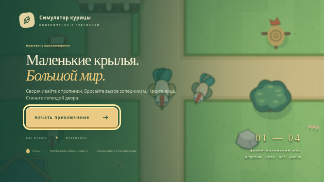

# Симулятор курицы — подготовка v0.3

**Маленькие крылья. Большой мир.** Браузерное приключение с видом сверху: исследуйте окрестности, сражайтесь с петухами, собирайте яйца и улучшайте своего героя. Игра работает без установки, сервера и платных сервисов.

Ветка `feat/golden-egg-heist-v0.3` создана от актуального `main` (`f2878e8`, после объединения PR #1). Уже реализована русская локализация существующей игры. Сюжетная кампания «Похищение золотого яйца», новые враги и новая способность пока не реализованы: полученное задание обрывается в разделе истории. Они не выдаются за готовые возможности этой промежуточной версии.

## Что уже работает

- Непрерывный мир размером 3072×2304, движение в любом направлении и плавная камера.
- Четыре связанные зоны: Куриная деревня, Солнечные поля, Тёмный лес и Арена чемпиона.
- Удар клювом, удар крылом, мощный пинок, защита, выносливость, комбо, отбрасывание и предупреждения об атаках.
- Новички, шустрые петухи, лесные забияки и чемпион с разными характеристиками и поведением.
- Гнёзда, ящики, тайники, манекен, диалоги, указатели, физический магазин и колокол вызова босса.
- Яйца как валюта, четыре направления улучшений, задания, миникарта и большая карта.
- Процедурные рисунки и звуки, независимые сенсорные касания, сохранения в браузере.
- Русские меню, диалоги, цели, уведомления, названия, подписи Canvas, сообщения сохранения и подписи доступности.



[Отчёт о проверках промежуточной версии](docs/VALIDATION-v0.3.md).

## Управление

Играйте на телефоне в горизонтальной ориентации. Слева находится джойстик, справа — действия. Движение и атаки поддерживают одновременные касания. При смене приложения игра ставится на паузу.

| Действие          | Телефон                    | Клавиатура       |
| ----------------- | -------------------------- | ---------------- |
| Движение          | Левый джойстик             | WASD или стрелки |
| Удар клювом       | Клюв                       | J                |
| Удар крылом       | Крыло                      | K                |
| Мощный пинок      | Пинок                      | L                |
| Защита            | Удерживать «Защита»        | Пробел           |
| Снести яйцо       | Снести яйцо                | V                |
| Взаимодействовать | Действие рядом с предметом | E                |
| Карта и задания   | Миникарта                  | M                |
| Пауза             | Кнопка паузы               | Escape           |

Поворачивайтесь к цели перед ударом. Красная дуга предупреждает об атаке противника: отойдите или защититесь. Чередуйте удары для комбо и делайте паузы для восстановления выносливости. В безопасной деревне восстанавливается здоровье.

Гнездо даёт три яйца и пополняется через минуту. Ящики можно открыть или разбить; иногда внутри два яйца. Тайники содержат пять яиц. Петух может снести яйцо раз в 30 секунд, но во время кладки уязвим. Награда сохраняется сразу, после чего отображается анимация яйца.

В деревенской «Перьевой кузнице» улучшаются сила атаки, здоровье, выносливость и производство яиц. За первую победу над чемпионом выдаются 25 яиц и Золотой гребень. Поражение не отнимает валюту и улучшения.

## Разработка

Для разработки нужны Node.js 22.12+ и npm. Для игры нужен только браузер.

```sh
npm ci
npm run dev
npm run typecheck
npm test
npm run test:browser
npm run build
npm run preview:pack
npm run preview
npm run format:check
```

Настоящее имя репозитория — **`Ilyanius31/chiken-simulator`**. Базовый путь Vite — **`/chiken-simulator/`**. В CI путь берётся из имени репозитория; при переименовании его можно переопределить через `PAGES_BASE_PATH`. Серверные маршруты не требуются.

Playwright использует системный Chromium (`/usr/bin/chromium`). На другой машине задайте `CHROMIUM_PATH`. Браузерные тесты управляют настоящей игрой через клавиатуру и касания. Данные позиции на Canvas доступны только для наблюдения: тест прохождения не телепортирует игрока и не подделывает награды. Отдельный сценарий миграции загружает старое сохранение намеренно.

`npm run format` форматирует исходники. `npm run preview:pack` после сборки создаёт единый HTML-файл в `artifacts/`. В него включены JavaScript, CSS и значок. Сценарий завершится ошибкой при неожиданном разделении JavaScript на дополнительные части, вместо создания неполного файла.

## Структура

```text
src/localization/  единый словарь русских текстов и тип будущих локализаций
src/core/          бои, ИИ, баланс, экономика, сохранения и жизненный цикл
src/world/         карта, камера, столкновения, навигация и взаимодействия
src/render/        оригинальные персонажи, окружение, эффекты и отрисовка
src/platform/      мультитач, клавиатура и Web Audio
src/ui/            меню, HUD, магазин, карта, диалоги и настройки
```

Симуляция работает с фиксированным шагом 1/60 секунды и ограничением догоняющих кадров. Логика тестируется отдельно от браузера. Рендеринг использует кэш ландшафта, отсечение объектов вне экрана и ограничение плотности пикселей до 2. Тяжёлых движков, библиотек ИИ и внешних ресурсов нет.

Все игровые тексты находятся в `src/localization/ru.ts`, а потребители импортируют `t` из `src/localization`. Будущая английская локализация должна реализовать тот же тип `Locale`; менять игровые идентификаторы не потребуется. Строки с числами представлены функциями, склонение слова «яйцо» использует `Intl.PluralRules`. Заголовок страницы и описание подставляются Vite из того же словаря. Системные шрифты поддерживают кириллицу; для текста Canvas используется системный шрифт.

## Сохранения

Локализация сохраняет существующую структуру `chicken-simulator:v2` и все ключи игровых объектов. Хранятся яйца, улучшения, статистика, звук, позиция, открытые зоны, сроки восстановления гнёзд, цели и награда чемпиона.

Старое сохранение `chicken-simulator:v1` переносится автоматически и остаётся нетронутым до явного подтверждения сброса. Поля проверяются отдельно; используется резервная копия. Неизвестная более новая версия защищена от перезаписи. При недоступном хранилище появляется русское предупреждение, а игра продолжает работать в текущей вкладке.

После перезапуска здоровье восстанавливается, а текущие столкновения с врагами начинаются заново. Сохранение принадлежит конкретному браузеру и адресу сайта. Очистка данных сайта удаляет его. Серверной синхронизации нет.

## Проверка и публикация с Android

Изменения публикуются через Pull Request. Агент не объединяет PR и не отправляет изменения непосредственно в `main`.

1. Откройте PR, изучите изменения, скриншоты и результаты проверок.
2. Для предварительной проверки откройте [GitHub Actions](https://github.com/Ilyanius31/chiken-simulator/actions) и скачайте артефакт последней сборки. Он содержит обычный статический сайт и единый HTML. Открытие локального HTML зависит от браузера и обработчика файлов Android; это не публичная HTTPS-версия.
3. Перед публикацией выберите [Settings → Pages](https://github.com/Ilyanius31/chiken-simulator/settings/pages) → **Build and deployment → Source → GitHub Actions**. В Chrome при необходимости включите «Версия для ПК».
4. Объедините готовый PR самостоятельно. После merge workflow проверит TypeScript, тесты и форматирование, соберёт сайт и опубликует его официальным механизмом GitHub Pages.
5. Дождитесь успешного задания `deploy` и используйте его ссылку или кнопку **Visit site**. Если Pages включили после неудачного запуска, повторите workflow для `main`.

Ожидаемый адрес: `https://ilyanius31.github.io/chiken-simulator/`. Его наличие в документации не означает, что публикация уже проверена. Предварительные сборки веток не заменяют основной сайт. Секретные ключи для штатного деплоя не нужны.

## Проверка на настоящем телефоне

Проверьте движение и атаки двумя пальцами, отмену касаний, паузу при переключении приложений и подсказку поворота. Прочитайте диалоги, откройте магазин и карту: русский текст не должен обрезаться. Соберите гнездо, снесите яйцо, разбейте ящик, победите новичка, купите улучшение, посетите лес и арену. Перезагрузите страницу и проверьте сохранение. Включите и выключите звук, отмените сброс прогресса.

Эмуляция Chromium не заменяет проверку удобства больших пальцев, звука и производительности на физическом Android. В игре пока один компактный мир, без мультиплеера, сложного инвентаря, крафта и облачных сохранений. Сначала следует завершить согласованный сюжет v0.3 и провести телефонное тестирование.
